# textora_lite 敲字与 IME 上屏延迟测量及优化方案

> 日期：2026-11-26  
> 适用范围：`textora_lite`（macOS `.app` / `lite` profile，后续同样适用于标准版 `textora`）  
> 目标：系统化测量普通按键（`Key`）及输入法（`ImePreedit` / `ImeCommit`）从事件进入应用到画面呈现的端到端延迟，并基于真实采样数据将软件端到端延迟收敛至 **15ms 以内**。

---

## 1. 背景与验收目标

### 1.1 测量口径（第一性原理区分）

输入延迟由系统侧与软件侧两段构成，必须明确区分才能准确归因和验收：

1. **软件端到端延迟（`e2e = T3 - T0`，直接测量与验收口径）**  
   从 winit 将 `WindowEvent` 投递进 `App::do_window_event` 的瞬间（`T0`），到 Metal swapchain 完成命令提交与 `output.present()` 返回的瞬间（`T3`）。该区间 100% 处于应用自身控制范围内。
2. **物理光子延迟（Glass-to-Glass，外部物理参考）**  
   在 `e2e` 之外，还包含两部分硬件/系统不可控时间：
   - `T0` 之前：键盘硬件扫描 / USB-Bluetooth HID 上报 / macOS `IMK`（系统输入法进程）与 AppKit 事件分发；
   - `T3` 之后：`CAMetalLayer` 提交给 WindowServer 合成并等待下一个显示刷新周期扫描到屏幕（60Hz 显示器为 0–16.7ms，120Hz ProMotion 为 0–8.3ms）。

### 1.2 量化验收指标

| 输入类别 | 硬性红线（软件 `e2e`） | 理想目标（软件 `e2e`） | 纯 CPU 预算（`handle + render_cpu + encode`） |
|---|---:|---:|---:|
| 普通按键 `Key`（英文/数字/符号/退格/换行） | **P95 ≤ 15.0ms** | P50 ≤ 8.0ms | < 3.0ms |
| IME 预编辑 `ImePreedit`（拼音串/候选更新） | **P95 ≤ 15.0ms** | P50 ≤ 8.0ms | < 3.0ms |
| IME 提交上屏 `ImeCommit`（中文选词上屏） | **P95 ≤ 15.0ms** | P50 ≤ 8.0ms | < 3.0ms |

> **关键约束**：若 CPU 侧总耗时超过单帧预算（120Hz 下约 8.3ms，60Hz 下约 16.7ms），容易错过当前 VSync 窗口并被推迟到下一刷新周期，导致延迟直接阶跃增加一整帧。

### 1.3 标准测试场景矩阵

采样时固定覆盖以下 4 个典型场景，避免只测空文档得出失真结论：

1. **短文档英文高速连打**：约 100 行纯文本文档中连续键入英文、空格、Backspace、Enter（至少 200 次按键样本）。
2. **短文档中文 IME 连续输入**：使用 macOS 自带拼音输入法连续输入词语、长句、退格修改拼音、数字键/空格选词上屏（至少 100 次 `ImePreedit` + 50 次 `ImeCommit`）。
3. **大文档（10k 行）中部/尾部编辑与中文 IME**：打开约 10,000 行（~500KB–1MB）纯文本/Markdown 文档，分别在文档中部与尾部执行英文连打与中文 IME 上屏。
4. **冷字形首次输入**：输入此前未进入 4096×4096 字形 Atlas 的生僻汉字或标点，观察首次 swash 光栅化与纹理上传的尖峰耗时。

---

## 2. 端到端时间轴与指标定义

### 2.1 事件到上屏全链路阶段划分

```mermaid
flowchart LR
    T0["T0: 进入 do_window_event (Key / Preedit / Commit)"]
    T1["T1: 输入事件处理完毕"]
    T2["T2: 进入 RedrawRequested"]
    T3["T3: output.present() 返回"]
    T4["T4: 帧尾 A11y 与 IME 光标更新完毕"]

    T0 -->|"handle (路由 + 编辑模型 + sync + IME坐标)"| T1
    T1 -->|"queue (about_to_wait + OS 重绘排队/VSync)"| T2
    T2 -->|"render_cpu (resize + prepare + paint + chrome + drain)"| T3_prep["Surface 提交前"]
    T3_prep -->|"acquire (get_current_texture)"| T3_enc["编码前"]
    T3_enc -->|"encode + submit (上传顶点 + present)"| T3
    T3 -->|"post_a11y (publish_accessibility_tree + IME坐标)"| T4
```



### 2.2 各分项指标精确定义

- **`e2e`（端到端总延迟）** = `T3 - T0`，是核心达标指标。
- **`handle`** = `T1 - T0`：包含模态/面板路由、IME 互斥守卫、`DocumentModel` 事务编辑或 `preedit` 更新、`sync_plugin_state()`、以及事件末尾的 `update_ime_cursor_area()`。
- **`queue`** = `T2 - T1`：从事件处理函数返回到系统真正派发 `WindowEvent::RedrawRequested` 的等待时间。
- **`render_cpu`** = `flush_pending_resize + sync_prepare + editor_paint + paint_chrome + drain_into`：主线程帧构建与排版光栅化总 CPU 耗时。
- **`acquire`** = `surface.get_current_texture()` 耗时（由 `appkit-shell` 的 `SurfaceFrameReport::Presented` 提供）。
- **`encode`** = 创建视图、上传顶点缓冲与编码 RenderPass 耗时。
- **`submit`** = `queue.submit()` + `output.present()` 耗时。
- **`post_a11y`** = `T4 - T3`：帧提交之后执行 `publish_accessibility_tree()` 与 `update_ime_cursor_area()` 的耗时；虽不计入当前帧 `e2e`，但若超过数毫秒会直接阻塞主线程、挤压下一击键的 `T0`。

### 2.3 边界语义与采样去重规则

1. **同帧事件合并（Coalescing）**  
   当一帧尚未呈现前连续收到多次输入事件时，以**最早一条未上屏事件的 `T0`** 作为该帧 `e2e` 的起点（反映用户最先敲下但仍未看到结果的最坏等待），并记录当前合并的事件数 `coalesced` 与最终类别。
2. **IME 双事件去重**  
   macOS + winit 0.30 在中文 IME 组合期间会同时派发 `KeyboardInput` 与 `Ime::Preedit`。被 `handle_keyboard` 中的 IME 互斥守卫拦截的按键（`is_ime_process_key` 或非白名单 `preedit` 期间的按键）以及纯修饰键、无文本修改效果的快捷键不记录为输入样本，避免虚增样本或覆盖真实 `ImePreedit` 的 `T0`。
3. **只追踪聚焦编辑区的有效输入**  
   覆盖文本插入、删除、换行、`Ime::Preedit` 变更及 `Ime::Commit` 上屏；鼠标移动、窗口焦点切换、光标闪烁触发的重绘不记入输入延迟样本。

---

## 3. 代码静态审计已识别的高嫌疑瓶颈

在尚未注入真实采样数据前，基于当前代码路径的静态审计发现以下 4 类高嫌疑热点（后续按实测数据逐一证伪或确认）：

1. **嫌疑 1：`Ime::Preedit` 未立即调用 `window.request_redraw()`，可能引入额外 `queue` 延迟**  
   - 普通按键与 `Ime::Commit` 通过 `AppEffect::REDRAW` 进入 `apply_effect`（[app.rs](file:///Users/dan/proj/llmws/textora/textora/crates/app/src/app.rs#L297-L300)），会同时执行 `schedule_redraw()` 与 `window.request_redraw()`；
   - 而 `WindowEvent::Ime(Ime::Preedit(..))`（[app_lifecycle.rs](file:///Users/dan/proj/llmws/textora/textora/crates/app/src/app_lifecycle.rs#L521-L562)）仅调用 `self.platform.schedule_redraw()`，需等待本轮事件清空后走到 `about_to_wait` 才触发 `window.request_redraw()`，不仅多绕一次循环，还可能在连续事件中延迟进入重绘队列。
2. **嫌疑 2：Swapchain `PresentMode::AutoVsync` 与 `desired_maximum_frame_latency: 2`**  
   - 当前 GPU 表面配置固定为 `PresentMode::AutoVsync` 且 `desired_maximum_frame_latency: 2`（[gpu.rs](file:///Users/dan/proj/llmws/textora/textora/crates/appkit-shell/src/gpu.rs#L416-L419)）。高速连打或 IME 连续候选切换时，`acquire`（`get_current_texture()`）或 `queue` 可能阻塞等待 VSync 信号或受 2 帧在途队列深度影响。
3. **嫌疑 3：每次事件/每帧无条件更新 IME 坐标与全量发布无障碍树**  
   - 每次 `do_window_event` 末尾（[app_lifecycle.rs](file:///Users/dan/proj/llmws/textora/textora/crates/app/src/app_lifecycle.rs#L880)）及 `about_to_wait` 末尾（[app_lifecycle.rs](file:///Users/dan/proj/llmws/textora/textora/crates/app/src/app_lifecycle.rs#L1244)）都会调用 `update_ime_cursor_area()` 查询光标矩形并跨 FFI 调用 macOS `set_ime_cursor_area`；
   - 每次 `RedrawRequested` 末尾（[app_lifecycle.rs](file:///Users/dan/proj/llmws/textora/textora/crates/app/src/app_lifecycle.rs#L869)）均无条件构造整棵无障碍语义树并调用 `adapter.update(&tree)`，高频连打时可能成为 `post_a11y` 拖累。
4. **嫌疑 4：编辑路径上的重复状态同步与每帧壳层 UI 重建**  
   - 在 `dispatch_transactional_edit` / `dispatch_ime_commit` 与 `finish_runtime_edit` 中（[editor.rs](file:///Users/dan/proj/llmws/textora/textora/crates/app/src/dispatch/editor.rs#L590-L622)），单次输入会多次调用 `sync_plugin_state()`；
   - 每帧 `update_shell_layout`（[app_renderer.rs](file:///Users/dan/proj/llmws/textora/textora/crates/app/src/app_renderer.rs#L830-L980)）会为所有标签重建 `TabInfo` 与文本测量，在大文档或多标签场景下可能放大 `render_cpu`。

---

## 4. 分阶段实施方案

严格遵循“**先测量定位、后定点优化；单子任务修改不超过 3 个文件；先写测试后改代码**”的原则，分四个阶段推进：

### 阶段 A：端到端输入延迟埋点（3 个文件）

1. **[platform_state.rs](file:///Users/dan/proj/llmws/textora/textora/crates/app/src/app/platform_state.rs)**
   - 新增类型驱动追踪器 `InputLatencyTracker` 与互斥类别枚举：
     - `InputEventKind { Key, ImePreedit, ImeCommit }`
     - `PendingInputSample { kind, first_t0, last_t1, coalesced, payload_bytes }`
   - 开关与落盘策略：仅当设置非空环境变量 `TEXTORA_INPUT_LOG` 时启用采样与追加写盘（未设置时零文件 I/O、零内存分配）；
   - **隐私红线**：结构化日志仅记录 `kind / e2e / handle / queue / render_cpu / acquire / encode / submit / post_a11y / coalesced / bytes / vertices`，**严禁记录任何按键内容、preedit 字符或文档片段**；
   - 补充单元测试验证：未启用环境变量零开销、同帧合并保留最早 `T0` 并累加 `coalesced`、呈现结算后清空挂起样本。

2. **[app_lifecycle.rs](file:///Users/dan/proj/llmws/textora/textora/crates/app/src/app_lifecycle.rs)**
   - 在 `WindowEvent::Ime(Ime::Preedit(..))`（仅当 `PreeditUpdate::Changed` 且非空清除冗余时）、`WindowEvent::Ime(Ime::Commit(..))`、以及真正产生文本编辑/光标动作的 `WindowEvent::KeyboardInput` 入口记录 `T0`，处理并完成事件结尾逻辑后记录 `T1`；
   - 在 `WindowEvent::RedrawRequested` 入口记录 `T2`，在 `publish_accessibility_tree()` + 帧尾 `update_ime_cursor_area()` 完成后记录 `post_a11y = T4 - T3` 并写入最终统计行。

3. **[app_renderer.rs](file:///Users/dan/proj/llmws/textora/textora/crates/app/src/app_renderer.rs)**
   - 在 `render_with_runtime_resources` 中复用已有的 `sync_prepare`、`editor_paint`、`paint_chrome`、`drain` 和 `resources.last_surface_report()`（含 `acquire`、`encode`、`submit_and_present`），将本帧渲染阶段耗时回传给 `PlatformState` 的挂起样本，待 `RedrawRequested` 末尾补齐 `post_a11y` 后统一输出一行。

### 阶段 B：真实环境采样与基线分析

1. 使用 `--profile lite` 重新打包 `target/textora_lite.app`（不改默认行为，通过环境变量按需开启采集）：
   ```bash
   rm -f /tmp/textora-input-latency.log
   open --env TEXTORA_INPUT_LOG=/tmp/textora-input-latency.log -n target/textora_lite.app
   ```
   （若 `open --env` 在某些 macOS 启动方式下未透传环境，可直接运行包内可执行文件进行同构采样：
   `TEXTORA_INPUT_LOG=/tmp/textora-input-latency.log ./target/textora_lite.app/Contents/MacOS/textora_lite`）
2. 按第 1.3 节的 4 个标准场景完成手工真实敲字与中文输入法采样，并记录当前屏幕刷新率（60Hz / 120Hz）与文档规模。
3. 编写一次性本地分析命令（或脚本置于会话临时目录）分别统计 `Key`、`ImePreedit`、`ImeCommit` 的样本数、`P50`、`P95`、`P99`、`Max`，重点拆解所有 **`e2e > 15ms`** 样本究竟卡在 `handle`、`queue`、`render_cpu`、`acquire`、`encode`/`submit` 还是前序帧 `post_a11y`。

### 阶段 C：数据驱动定点优化（按实测热点裁剪执行）

仅对阶段 B 实测证明显著的超标项实施优化，不叠加未经证实的防御补丁；每项改动先补回归测试，再实施 A/B 对比：

- **若热点在 `queue`（尤其是 `ImePreedit`）**：
  - 让 `Ime::Preedit` 在状态变更后立即 `window.request_redraw()`（与 `Key` / `Ime::Commit` 对齐），并在合理路径上评估是否需要区分“首次变更立即重绘”与“高频合并”。
- **若热点在 `acquire` / VSync 排队**：
  - 在 macOS Metal 后端上对 `desired_maximum_frame_latency`（`1` vs `2`）与 `PresentMode`（`AutoVsync` vs `Mailbox` / `AutoNoVsync`，以及 `CAMetalLayer` 可用模式）进行严格 A/B 实测，在输入延迟与功耗/撕裂之间选择最优值。
- **若热点在 `handle` 或 `post_a11y`**：
  - 按需节流或脏标记跳过无变更的 `update_ime_cursor_area()` 与 `publish_accessibility_tree()`（例如仅在光栅布局或无障碍节点实际变动时重建，或避免在未开启 VoiceOver/辅助功能客户端时每帧全量构造树）；
  - 消除编辑事务单次输入中的冗余 `sync_plugin_state()`。
- **若热点在 `render_cpu`（尤其大文档或冷字形）**：
  - 优化 `update_shell_layout` 中标签与状态栏的脏检查缓存（未切换标签/未增删标签时不重造全量 `TabInfo` 列表）；
  - 针对冷字形/局部重绘排查 shaping 与 Atlas 上传热点，确保局部单行编辑不触发全屏无关重算。

### 阶段 D：回归验收、文档回填与打包交付

1. 在相同设备与 4 个标准场景下重采优化后样本，对比修复前/后分位数，验证 `Key`、`ImePreedit`、`ImeCommit` 全部满足 **P95 ≤ 15ms**。
2. 运行 `./scripts/verify.sh`（架构边界、`cargo fmt --check`、`cargo clippy -- -D warnings`、全量单测与集成测试）。
3. 运行 `./scripts/bundle-textora-lite-mac.sh` 产出最终版 `target/textora_lite.app`。
4. 将最终实测数据回填至本文档第 6 节并保留 `TEXTORA_INPUT_LOG` 环境变量按需采样能力（默认关闭、零开销）。

---

## 5. 隐私与测量纪律

1. **零明文原则**：日志中绝不出现任何按键字符、IME 候选词、preedit 串、文件路径或文档内容，只允许记录事件类别枚举与字节长度。
2. **先证后改**：任何优化必须对应阶段 B 中的具体瓶颈环节，禁止猜测性微调；若某个环节实测低于 `0.5ms`，不得为它增加代码复杂度。
3. **单一职责与可验证性**：埋点开关、样本聚合、日志格式各自独立可测；未开启 `TEXTORA_INPUT_LOG` 时，热路径只增加一次 `Option` 判空成本。

---

## 6. 实测基线与优化记录（待采样后回填）

> 测试环境：设备型号 / macOS 版本 / 显示器刷新率（待填写）

### 6.1 基线数据（优化前）

| 输入类别 | 场景 | 样本数 | P50 (ms) | P95 (ms) | P99 (ms) | Max (ms) | 主要瓶颈阶段 |
|---|---|---:|---:|---:|---:|---:|---|
| `Key` | 短文档英文连打 | - | - | - | - | - | 待采样 |
| `ImePreedit` | 短文档中文 IME | - | - | - | - | - | 待采样 |
| `ImeCommit` | 短文档中文 IME | - | - | - | - | - | 待采样 |
| `Key` / `IME` | 10k 行大文档 | - | - | - | - | - | 待采样 |

### 6.2 优化后对比（A/B 验收）

| 输入类别 | 优化前 P95 (ms) | 优化后 P95 (ms) | 变化 | 主要改动项 |
|---|---:|---:|---|---|
| `Key` | - | - | - | 待回填 |
| `ImePreedit` | - | - | - | 待回填 |
| `ImeCommit` | - | - | - | 待回填 |
