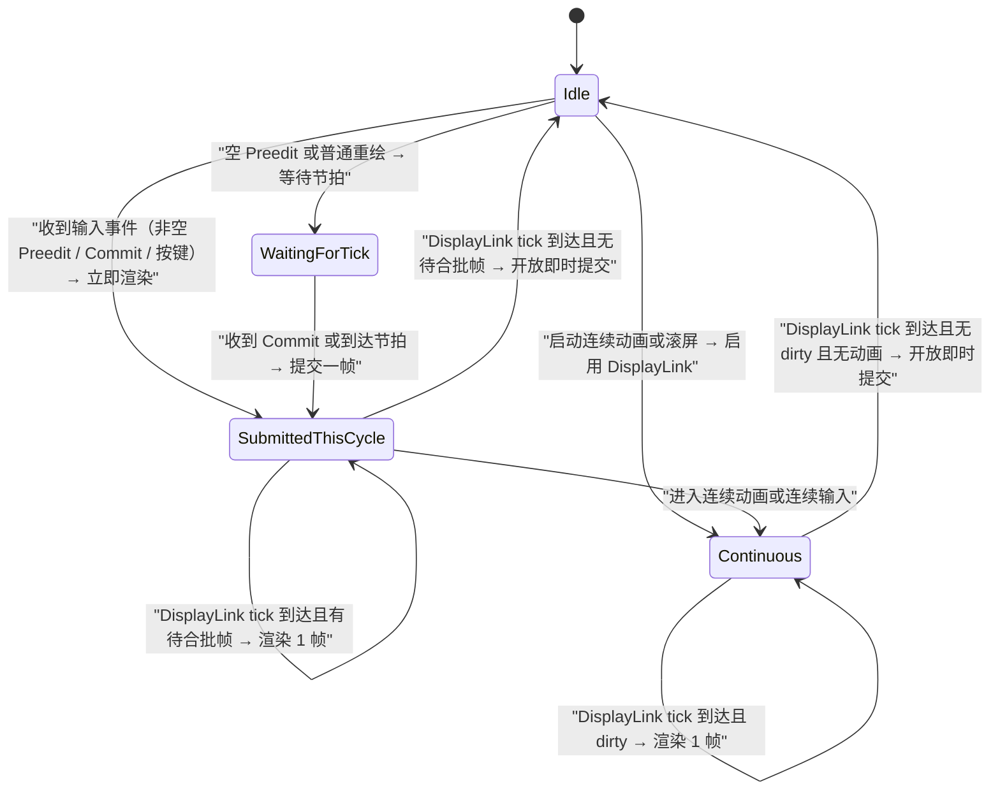

# Textora Lite 输入上屏延迟优化与混合帧节拍调度设计

- **日期**：2026-11-27
- **状态**：代码已实施，实测结果见第八节
- **关联测量记录**：[2026-11-26-textora-lite-input-latency.md](./2026-11-26-textora-lite-input-latency.md)
- **涉及 Crate**：`crates/render`、`crates/appkit-shell`、`crates/app`、`crates/notora-app`、`crates/textora-lite`（严守 `AGENTS.md` 依赖层次，**不触碰 `crates/ui`**）

---

## 一、背景与双口径基线现状

在 Apple M5、macOS 27.0.1、60 Hz 内置视网膜屏（`3420×2214` 物理像素）全屏无遮挡条件下，通过 Computer Use 逐键输入独立纯文本文档，并将应用埋点（`TEXTORA_INPUT_LOG`）与 AppKit 本地按键监视器及 `MTLDrawable.presentedTime` 逐帧配对（最大配对误差 `27 µs`），得到当前 release 版 Textora Lite 的双口径实测基线。

### 1.1 口径 1：不含屏幕硬件刷新（事件到达 → GPU 提交 / 完成）

| 输入类型 | 样本数 | `callback → submit`（应用内） | `appkit → submit`（含 winit / IME） | `event → submit`（含系统事件投递） | 15 ms 达标结论 |
|---|---:|---|---|---|---|
| 普通插入/退格（`ordinary/Key`） | 100 | **0/100 超标**<br>P50 `1.05 ms` · P95 `1.44 ms` · Max `1.97 ms` | **0/100 超标**<br>P50 `1.26 ms` · P95 `3.74 ms` · Max `12.42 ms` | 7/100 超标<br>P50 `2.13 ms` · P95 `15.98 ms` · Max `19.28 ms` | 应用 CPU 已达标；GPU 与系统投递偶发尖峰 |
| 简体拼音选词提交（`ImeCommit`） | 25 | **0/25 超标**<br>P50 `4.11 ms` · P95 `6.22 ms` · Max `7.75 ms` | **0/25 超标**<br>P50 `4.87 ms` · P95 `7.06 ms` · Max `8.44 ms` | 1/25 超标<br>P50 `5.23 ms` · P95 `11.89 ms` · Max `20.88 ms` | 到 `submit` 已达标；存在 `3~6 ms` 无谓重绘排队 |
| 简体拼音预编辑（`ImePreedit`） | 125 | **21/125 超标**<br>P50 `8.93 ms` · P95 **`20.73 ms`** · Max `28.50 ms`<br>（其中 `redraw_queue` P95 `20.02 ms`，帧构建 `0.56 ms`） | **32/125 超标**<br>P50 `11.88 ms` · P95 **`23.05 ms`** · Max `31.13 ms` | **56/125 超标**<br>P50 `13.67 ms` · P95 **`27.88 ms`** · Max `38.54 ms` | **明确不达标**（仅应用内已超 20 ms） |

单独窗口模式 Metal GPU 跟踪（168 张编辑帧、共 1,008 次 `MTLCommandBuffer` 提交）显示：
- `editor frame pass`（提交到 GPU 完成）：P50 `1.70 ms` · P95 **`4.59 ms`** · Max **`17.03 ms`**；
- `(wgpu internal) Present`：P50 `1.63 ms` · P95 `4.66 ms` · Max `16.95 ms`。

### 1.2 口径 2：含屏幕硬件刷新（系统事件 → `MTLDrawable.presentedTime`）

| 全屏场景 / 输入类型 | 样本数 | 超过 15 ms | P50 | P95 | 最大值 | 关键阶段特征 |
|---|---:|---:|---:|---:|---:|---|
| ABC 普通插入和退格 | 100 | 41 / 100 | `13.27 ms` | `31.84 ms` | `56.56 ms` | 58/100 走直通（`submit_to_display < 10 ms`，最低 `6.58 ms`）；41 个超标样本中 29 个伴随 `event_to_appkit > 2 ms`，18 个 `submit_to_display > 15 ms` |
| 简体拼音预编辑 | 125 | 124 / 125 | `37.35 ms` | `65.08 ms` | `85.08 ms` | `redraw_queue` P95 `20.02 ms`；`submit_to_display` P50 `20.86 ms` · P95 `47.93 ms`（锁 60 Hz 合成） |
| 简体拼音选词提交 | 25 | 20 / 25 | `27.08 ms` | `63.22 ms` | `66.63 ms` | `redraw_queue` P50 `3.18 ms`；`submit_to_display` P50 `20.74 ms` · P95 `44.46 ms` |
| 拼音段内退格（`ime/Key`） | 50 | 40 / 50 | `27.20 ms` | `45.03 ms` | `45.78 ms` | `callback → submit` P95 `1.29 ms`，但 `submit_to_display` P50 `24.24 ms` · P95 `41.66 ms` |

### 1.3 60 Hz 物理边界说明

`native.log` 显示存在两条截然不同的硬件上屏路径：
1. **Direct-to-Display 直通路径**（`displaySyncEnabled = false` 且窗口未被系统悬浮层遮挡）：`submit_to_display` 可低至 `4.36 ~ 9.9 ms`，端到端最低 `6.58 ms`。
2. **WindowServer 60 Hz 合成路径**（普通窗口模式，或全屏下被系统拼音候选词浮窗遮挡）：`presentedTime` 严格对齐 60 Hz 网格（周期 $T = 16.67\text{ ms}$）。在合成模式下，**单帧刷新周期本身即大于 `15 ms`**，即使应用 0 ms 完成提交，也不可能承诺每次物理上屏均小于 `15 ms`。

因此必须将目标拆分为**双口径**：先以硬门禁消灭软件与 GPU 侧超标（不考虑屏幕刷新全面达标 `< 15 ms`），再通过消除多余帧、压低排队深度与混合节拍调度，在考虑屏幕刷新时做到**稳定命中最近 1 个刷新周期**的最优体验。

---

## 二、目标与双口径验收标准

设显示刷新周期为 $T = 1000 / \text{Hz}$（60 Hz 下 $T = 16.67\text{ ms}$，120 Hz ProMotion 下 $T = 8.33\text{ ms}$）。

| 口径 | 衡量维度 | 目标指标 | 覆盖范围 |
|---|---|---|---|
| **目标 1：不含屏幕刷新**（硬门禁 `< 15 ms`） | 应用回调到提交（`callback → submit`） | 普通键、拼音预编辑、拼音提交 **P95 < 3 ms，Max < 8 ms** | Lite / Textora / Notora 共享运行时 |
| **目标 1：不含屏幕刷新** | GPU 渲染 Pass（`editor frame pass`） | **P95 < 1.5 ms，Max < 3 ms** | 3420×2214 全屏纯文本渲染 |
| **目标 1：不含屏幕刷新** | `appkit_received → GPU 完成` | 普通键 **P95 < 4 ms**；拼音预编辑/提交 **P95 < 8 ms** | 含 `winit` 与系统输入法前序开销 |
| **目标 2：含屏幕刷新**（归一化体验最优） | `appkit_received → presentedTime` | 合成态 **P50 ≤ 1.0×T，P95 ≤ 1.5×T**；消灭 **> 2.5×T** 毛刺 | 60 Hz 窗口/拼音：P50 ≤ 16 ms，P95 ≤ 25 ms<br>120 Hz 屏全场景：P50 ≤ 8.3 ms，P95 ≤ 12.5 ms |
| **目标 2：含屏幕刷新** | 全屏无遮挡直通路径（ABC 普通键） | **P50 ~8–10 ms，P95 < 15 ms** | 保持 Direct-to-Display 稳定性 |
| **目标 2：含屏幕刷新** | 连续滚屏 / 动画 / 队列健康度 | 帧间隔对齐 $1 \times T$；零 `presentedTime = 0` 丢帧爆发；空闲停止显示节拍回调 | 含触摸板滚屏、拖拽选区、侧栏/标签栏动画 |

---

## 三、根因分析

### 根因 1：`winit` 同步派发 IME 与 `request_redraw()` 延迟排队，外加无条件 `update_ime_cursor_area()`

- `winit 0.30.13` macOS 端 `WinitView::key_down` 会同步调用 `self.interpretKeyEvents(&events_for_nsview)` 与系统输入法（`SCIM`）XPC 通信；在 `interpretKeyEvents:` 返回前同步触发 `set_marked_text` / `insert_text` 回调，进而同步进入 `App::do_window_event`。
- 当前在 [crates/app/src/app_lifecycle.rs](file:///Users/dan/proj/llmws/textora/textora/crates/app/src/app_lifecycle.rs#L531-L646) 中，`Ime::Preedit` 和 `Ime::Commit` 只调用 `schedule_redraw()` / `request_redraw()`。`winit` 的 `ApplicationDelegate::queue_redraw` 仅将 `window_id` 压入 `pending_redraw`，**必须等到 `interpretKeyEvents:` 完全返回且 `CFRunLoop` 进入 `kCFRunLoopBeforeWaiting` 时才在 `ApplicationDelegate::cleared` 中派发 `RedrawRequested`**。编辑器被迫干等系统拼音完成候选词计算，产生 `5 ~ 27.68 ms` 的纯等待（`redraw_queue`）。
- 更严重的是，系统会分别在 [do_window_event 尾部](file:///Users/dan/proj/llmws/textora/textora/crates/app/src/app_lifecycle.rs#L916)、[App::dispatch 循环内部](file:///Users/dan/proj/llmws/textora/textora/crates/app/src/dispatch/mod.rs#L92) 和 [about_to_wait 尾部](file:///Users/dan/proj/llmws/textora/textora/crates/app/src/app_lifecycle.rs#L1314) 三处**无条件调用** [App::update_ime_cursor_area](file:///Users/dan/proj/llmws/textora/textora/crates/app/src/app_window.rs#L275-L318)。而 `winit` 的 `WinitView::set_ime_cursor_area` 每次都会直接调用 `input_context.invalidateCharacterCoordinates()`，在尚未重绘出新几何时强迫 TSM/SCIM 同步重查光标区域并加重 IPC 阻塞。

### 根因 2：3420×2214 全屏 4x MSAA + `StoreOp::Store` + 每帧多 CommandBuffer 拆分

- [crates/appkit-shell/src/gpu.rs](file:///Users/dan/proj/llmws/textora/textora/crates/appkit-shell/src/gpu.rs#L133-L153) 与 [crates/render/src/lib.rs](file:///Users/dan/proj/llmws/textora/textora/crates/render/src/lib.rs#L415) 原先硬编码了 `sample_count: 4`。在 `3420×2214` 分辨率下，4x MSAA 颜色附件若回写全部样本，一帧约写入 **121 MB**。保留 4x MSAA 与现有像素输出，优化颜色附件的存储和解析路径。
- [crates/appkit-shell/src/editor_runtime/editor_frame.rs](file:///Users/dan/proj/llmws/textora/textora/crates/appkit-shell/src/editor_runtime/editor_frame.rs#L209-L212) 在 `resolve_target` 为 `Some(&surface_view)` 时仍使用 `wgpu::StoreOp::Store`，迫使 Apple Silicon TBDR GPU 将全部 121 MB 多采样片上内存回写到系统内存。
- 同文件中每帧调用 `queue.write_buffer(&text.vertex_buffer, ...)`（由 `wgpu` 内部拆出 `(wgpu internal) PendingWrites`、`(wgpu internal) Pre Pass`、`(wgpu internal) Transit`、`editor frame pass` 与 `(wgpu internal) Present` 共 5~6 个 `MTLCommandBuffer`），叠加带宽压力使 `editor frame pass` GPU 完成 P95 达到 `4.59 ms`、最坏 `17.03 ms`。

### 根因 3：合成队列深度过深与全屏直通稳定性被破坏

- 系统拼音候选浮窗覆盖在编辑器上方时，macOS WindowServer 退出 Direct-to-Display 并回落合成模式（连同拼音段内普通退格键 `ime/Key` 的 `submit_to_display` 中位数也跳升至 `24.24 ms`）。
- [crates/appkit-shell/src/gpu.rs](file:///Users/dan/proj/llmws/textora/textora/crates/appkit-shell/src/gpu.rs#L431) 配置 `desired_maximum_frame_latency: 2`（即 `CAMetalLayer.maximumDrawableCount = 3`），在合成态或突发多帧时允许积压 3 个 drawable（最坏排队 `~50 ms`）。
- [crates/app/src/app_window.rs](file:///Users/dan/proj/llmws/textora/textora/crates/app/src/app_window.rs#L463-L466) 默认启用 `with_titlebar_transparent(true)` 与 `with_fullsize_content_view(true)`，如果全屏状态下透明标题栏或非不透明窗口属性未隔离，也容易在无候选窗时随机触发 WindowServer 退回合成路径（如 `key=1193, 1210, 1274` 出现 `39 ~ 53 ms` 延迟）。

### 根因 4：单次按键触发多帧重绘与丢帧阻塞

- `native.log` 显示每轮拼音首键（`key=988, 996, 1004, 1020...`）连续获取 **3~4 个 drawable**（且第 1 个常因后帧立即覆盖而报告 `presentedTime = 0` 被系统丢弃）；普通英文键亦出现偶发双帧（如 `key=1252` 间隔 `~600 µs` 连续获取两个 drawable）。
- 已知触发源包括：`Ime::Enabled` 在无视觉状态变更时调用 [schedule_redraw](file:///Users/dan/proj/llmws/textora/textora/crates/app/src/app_lifecycle.rs#L591)；[update_shell_layout](file:///Users/dan/proj/llmws/textora/textora/crates/app/src/app_renderer.rs#L1025-L1027) 的 `dock_is_dirty()` 以及帧尾 `about_to_wait` 状态循环导致的二次 `request_redraw()`。

### 根因 5：`event_to_appkit_ms` 调度抖动与观测口径混杂

- 普通英文键 41 个超 15 ms 的样本中，有 **29 个**存在 `event_to_appkit_ms > 2 ms`（最高 `16.94 ms`）。
- 一方面应用未向 macOS 声明交互低延迟 QoS（`NSActivityUserInteractive | NSActivityLatencyCritical`），主线程在短歇后容易落入低功耗调度或核间迁移；另一方面自动化工具（Computer Use）注入事件到 `NSEvent.timestamp` 本身包含注入链路抖动，复测分析必须同时拆分 `event → presented` 与 `appkit_received → presented`。

---

## 四、帧节拍调度设计：为什么选“混合调度”而非“全对齐刷新节拍”

### 4.1 三种调度策略的定量对比

设刷新周期为 $T$，优化后单帧 CPU+GPU 耗时为 $t_{\text{work}} \approx 1.5\text{ ms}$，WindowServer 合成截止线在 VSync 前 $d \approx 2\text{ ms}$，输入在周期内均匀到达（$t_{\text{in}} \in [0, T)$）：

1. **全对齐显示刷新节拍（纯 DisplayLink）**：按键仅标脏，必须等到下一个 DisplayLink tick（平均白等 $0.5T$）才开始渲染，该帧无法赶上本次扫描，最早在 $2T$ 上屏。端到端延迟落在 $[1T, 2T]$。
2. **无节拍纯立即提交**：每次事件直接提交。单键可抢进当前周期，但快速输入或冗余请求会瞬间塞满 2~3 个 drawable，导致丢帧（`presentedTime = 0`）与队列滞后。
3. **混合调度（首帧即时 + 同周期节拍合批）**：若当前刷新周期尚未提交帧（`Idle`），输入立即原地渲染提交，约有 $(T - t_{\text{work}} - d) / T \approx 79\%$（60 Hz 下）的概率赶上紧接着的这一次 VSync；若同周期内再次发生输入或处于连续滚屏/动画中，后续请求挂起并对齐下一个 DisplayLink tick 合批提交。

| 评估维度 | 全对齐 DisplayLink | 无节拍纯立即提交 | **混合调度（本设计选用）** |
|---|---|---|---|
| **60 Hz 窗口 / 拼音单键延迟** | P50 `~25 ms` · P95 `~33 ms` | P50 `~12 ms`（突发易堆成 `40 ms+`） | **P50 `~12 ms` · P95 `~20 ms`** |
| **60 Hz 全屏普通键延迟** | P50 `~25 ms`（放弃直通优势） | `7~9 ms`（偶发双帧抖动） | **P50 `~8–10 ms` · P95 `< 15 ms`** |
| **120 Hz ProMotion 单键延迟** | P50 `~12.5 ms` · P95 `~16 ms` | P50 `~6 ms`（高频事件易丢帧） | **P50 `~6–8 ms` · P95 `< 12 ms`** |
| **30 Hz 外屏单键延迟** | P50 `~50 ms` · P95 `~65 ms` | P50 `~25 ms` | **P50 `~25 ms` · P95 `~35 ms`** |
| **连续滚屏 / 动画平滑度** | 极佳 | 一般（无周期锁定） | **极佳（严格 $1 \times T$ 合批）** |
| **全对齐的隐藏陷阱** | 1. 同样被 `interpretKeyEvents:` 阻塞<br>2. 同样受 4x MSAA 尖峰拖累<br>3. 单键固定多罚 ~0.8 帧 | 突发多帧易打爆交换链 | **配合阶段 1+2 底座可规避全部陷阱** |

### 4.2 混合帧节拍状态机（`FramePacer`）

在 `crates/appkit-shell` 中以类型驱动枚举实现状态机，严禁组合多个 `bool` 字段：

```rust
pub enum PacerState {
    /// 空闲：DisplayLink 停止，事件循环处于 ControlFlow::Wait（零唤醒）。
    Idle,
    /// 本刷新周期已即时提交 1 帧，周期门控激活，等待下一个 DisplayLink tick。
    SubmittedThisCycle {
        pending_followup: bool,
    },
    /// 连续更新态（滚屏 / 拖拽 / 侧栏或标签栏动画），所有帧均在 DisplayLink tick 内合批提交。
    Continuous {
        dirty: bool,
    },
}
```



**关键迁移约束**：
- 只有产生**实际内容或可见交互变化**的输入事件（非空 `Ime::Preedit`、`Ime::Commit`、编辑/导航按键）才允许在 `Idle` 下触发即时提交；空 `Ime::Preedit("", None)` 只标脏不触发即时提交，等待紧随其后的 `Ime::Commit` 或周期收口。
- 一旦处于 `SubmittedThisCycle`，同一刷新周期内所有后续重绘请求（包含 `MouseMoved`、`dock_is_dirty`、或连续快速敲击）只更新 `pending_followup = true`，严格保证**每周期至多 1 个 drawable**。
- 第一个静默节拍开放下一次即时提交，第二个静默节拍暂停 DisplayLink。光标闪烁和文件安全检查保留独立的事件循环唤醒。迟到的 DisplayLink 回调使用原始显示节拍时间戳，旧节拍不会触发刚提交过的帧。

### 4.3 macOS DisplayLink 与跨平台适配

- **macOS 14+**：通过 `NSWindow::displayLinkWithTarget:selector:` 创建与窗口所在显示器绑定的 `CADisplayLink`（比已废弃的 `CVDisplayLink` 天然支持 ProMotion VRR 且跟随窗口所在屏幕）。
- **ProMotion 高刷保障**：激活连续节拍时配置 `preferredFrameRateRange`（允许最高刷新率，如 `60..=120` Hz），避免零星输入或轻微滚动被系统降频到 60 Hz 或更低档位。
- **跨屏与兼容降级**：`NSWindow` 创建的 DisplayLink 由 AppKit 自动跟随所在屏幕。`NSWindowDidChangeScreenNotification` 用于更新刷新率范围。在 macOS < 14、测试环境或非 macOS 平台上，通过 `crates/appkit-shell` 内的 `DisplayPacingBackend` trait 退化为基于 `Instant + ControlFlow::WaitUntil` 的固定周期回退实现，保持跨平台与单测可用性。

---

## 五、模块边界与核心接口设计

严格遵循 `AGENTS.md` 依赖分层红线：`crates/ui` 保持纯数据与无状态；所有通用 GPU、Surface、IME 缓存与节拍调度能力沉淀到 `crates/render` 与 `crates/appkit-shell`，`crates/app`（含 Textora Lite）及 `crates/notora-app` 仅做薄接入。

### 5.1 `crates/render`

- 新增可配置采样数的构造接口，保留现有默认值兼容迁移：
  ```rust
  impl GlyphRenderer {
      pub fn new_with_sample_count(
          device: &wgpu::Device,
          format: wgpu::TextureFormat,
          sample_count: u32,
      ) -> Self { /* ... */ }
  }
  ```
- 将 `GlyphRenderer::new(device, format)` 设为调用 `new_with_sample_count(device, format, 4)` 或按各 caller 显式传入目标采样数。

### 5.2 `crates/appkit-shell`

1. **抗锯齿策略枚举 `SurfaceAntialiasing`**（替代隐式硬编码 4x MSAA）：
   ```rust
   #[derive(Clone, Copy, Debug, Default, PartialEq, Eq)]
   pub enum SurfaceAntialiasing {
       /// 1x 直接渲染至 Swapchain Surface，仅用于显式诊断对照。
       None,
       /// 4x MSAA，保留现有抗锯齿效果，解析后丢弃临时多采样附件。
       #[default]
       Msaa4x,
   }
   ```
   - `TEXTORA_SURFACE_SAMPLE_COUNT=1` 显式启用 `SurfaceAntialiasing::None`，它直接渲染到表面，无需分配多采样附件。Textora、Lite 和 Notora 统一默认使用 `Msaa4x`。
   - 采用 `Msaa4x` 时，把多采样纹理标记为 `TRANSIENT`，解析到表面后用 `wgpu::StoreOp::Discard` 免除多采样附件回写。
2. **Surface 队列深度与环境变量开关**：
   - 在 `crates/appkit-shell/src/gpu.rs` 中将 macOS `desired_maximum_frame_latency` 默认调整为 `1`（`maximumDrawableCount = 2`），同时支持诊断环境变量（如 `TEXTORA_MAX_FRAME_LATENCY`）用于同机 A/B 对比。
   - 阶段 2 若 Instruments 复测显示 `PendingWrites` 仍占明显开销，在 `TextState` 增加 2~3 槽位的 `VertexRingBuffer` 轮转映射。
3. **IME 光标区域去重缓存 `ImeCursorAreaCache`**：
   - 在 `crates/appkit-shell/src/window_input.rs`（或 `editor_runtime`）定义纯值类型缓存，将物理坐标量化为整数像素 `(x, y, w, h)`，仅在相比上次已提交值发生变化（或显式失效）时才调用 `window.set_ime_cursor_area(...)`。
4. **混合节拍器与 macOS 系统集成**：
   - `crates/appkit-shell/src/frame_pacer.rs`：`FramePacer` 状态机与 `DisplayPacingBackend` 抽象；
   - `crates/appkit-shell/src/macos/display_link.rs`：`CADisplayLink` 包装与跨屏重绑；
   - `crates/appkit-shell/src/macos/qos.rs`：`LatencyCriticalActivity`（RAII 封装 `NSProcessInfo.processInfo` `beginActivityWithOptions:reason:`，聚焦期间启用 `NSActivityUserInitiatedAllowingIdleSystemSleep | NSActivityLatencyCritical`）。

### 5.3 `crates/app`（含 Lite）与 `crates/notora-app`

- **输入回调即时提交收口函数**（如 `App::present_after_input_if_paced`）：
  - 统一处理重入守卫、检查 `FramePacer::should_render_immediately_on_input()`；
  - 渲染完成后清除 `redraw_pending` 与 `render_session` 标记，随后在统一收口点调用去重后的 `update_ime_cursor_area()`，并向 `InputLatencyLog` 结算 `finish_redraw(...)`。
- **全屏不透明隔离**：全屏模式下确保 `NSWindow.setOpaque(true)`，核查标题栏透明叠加视图不覆盖编辑器 `CAMetalLayer` 区域，避免无候选窗时意外退出 Direct-to-Display。
- **`notora-app` 对齐**：在 `crates/notora-app/src/runtime/frame_runtime.rs` 及 `events.rs` 中复用 `ImeCursorAreaCache`、`FramePacer` 与默认的 `Msaa4x` 表面渲染路径。

---

## 六、分阶段实施计划与子任务拆分

> **执行纪律**：严格遵守单子任务修改 **不超过 3 个文件**；每阶段完成均运行相关单测、`./scripts/verify.sh`，并重新打包 Textora Lite 用同款探针 A/B 复测验证。

### 阶段 1：IME 去阻塞、坐标去重与冗余帧清理（优先让口径 1 全面达标）

| 子任务 | 修改内容 | 涉及文件（≤ 3） | 验证方式 |
|---|---|---|---|
| **1.1 IME 坐标去重与后置** | 新增 `ImeCursorAreaCache`；移除 `dispatch/mod.rs` 循环及 `about_to_wait` 无条件调用，收敛至渲染完成与必要导航后按需触发 | 1. `crates/appkit-shell/src/window_input.rs`<br>2. `crates/app/src/app_window.rs`<br>3. `crates/app/src/dispatch/mod.rs`（`app_lifecycle.rs` 调用点清理随 1.2 一并完成） | 单元测试验证连续同坐标不重复下发；中文输入候选窗位置跟随正常 |
| **1.2 输入回调原地提交** | 在 `Ime::Preedit`（仅非空文本）、`Ime::Commit`、编辑键命中且 `FramePacer` 允许立即渲染时，原地调用 `render()` 并消费 `redraw_pending`；空 `Preedit("", None)` 保持延迟合并 | 1. `crates/app/src/app_lifecycle.rs`<br>2. `crates/app/src/app/platform_state.rs`<br>3. `crates/app/src/app_tests.rs` | 新增单测：验证非空 Preedit 立刻完成帧结算、空 Preedit 不抢跑、`Commit` 紧随空 Preedit 只出 1 帧 |
| **1.3 清理冗余多帧** | 移除 `Ime::Enabled` 无状态变更的 `schedule_redraw()`；审计并消除 `app_renderer.rs` 中 `dock_is_dirty()` / `about_to_wait` 引起的同键 600 µs 双帧 | 1. `crates/app/src/app_lifecycle.rs`<br>2. `crates/app/src/app_renderer.rs` | 单测断言单次普通插入与单次拼音预编辑仅触发 1 次 `render`；Lite 探针验证首键 drawable 数从 `3~4` 降至 `1` |

- **阶段 1 验收目标**：`./scripts/verify.sh` 通过；Lite 探针复测 `ImePreedit` 的 `redraw_queue` P95 从 `20.02 ms` 降至 `< 1 ms`，`callback → submit` 全输入类型 P95 `< 3 ms`，口径 1 主瓶颈清零。

### 阶段 2：GPU 渲染减负、队列深度与系统调度（压低 GPU 尖峰与呈现排队）

| 子任务 | 修改内容 | 涉及文件（≤ 3） | 验证方式 |
|---|---|---|---|
| **2.1 渲染管线支持 1x 与 Discard** | `GlyphRenderer` 支持 `sample_count`（1x / 4x）；`GpuContext` 按 `SurfaceAntialiasing` 按需创建 MSAA；MSAA 附件改 `StoreOp::Discard` | 1. `crates/render/src/lib.rs`<br>2. `crates/appkit-shell/src/gpu.rs`<br>3. `crates/appkit-shell/src/editor_runtime/editor_frame.rs` | `cargo test -p textora-render -p textora-appkit-shell` 与 `image_readback` 通过 |
| **2.2 保留 4x MSAA 默认画质** | `TextState` 使用与表面一致的采样数，1x 作为显式诊断对照。验证 `Discard` 和 `Store` 的 4x 输出像素一致 | 1. `crates/appkit-shell/src/render_state.rs`<br>2. `crates/appkit-shell/src/editor_runtime/render_session.rs`<br>3. `crates/app/src/app_renderer.rs` | `render_smoke` 与界面视觉走查字形边缘清晰度 |
| **2.3 队列深度与 QoS / 直通保护** | macOS `desired_maximum_frame_latency = 1`；增加 `macos::qos` 开启 `NSActivityLatencyCritical`；全屏模式维护 `NSWindow.isOpaque = YES` | 1. `crates/appkit-shell/src/gpu.rs`<br>2. `crates/appkit-shell/src/macos.rs`（含子模块）<br>3. `crates/app/src/app_window.rs` | Instruments Metal Trace 复测 `editor frame pass` P95 `< 1.5 ms`；Lite 探针验证 `submit_to_display` 长尾收敛 |
| **2.4（按需）顶点环形缓冲** | 若 2.3 后 `PendingWrites` 仍造成 > 0.5 ms 阻塞，将 `vertex_buffer` 改为双/三缓冲轮转 | 1. `crates/appkit-shell/src/render_state.rs`<br>2. `crates/appkit-shell/src/editor_runtime/editor_frame.rs` | Instruments Trace 命令缓冲数与耗时复测 |

- **阶段 2 验收目标**：`./scripts/verify.sh` 通过；口径 1 下 `appkit → GPU 完成` 全场景 `< 8 ms`（远低于 `15 ms` 红线）；口径 2 下 60 Hz 全屏普通键直通稳定性大幅提升，长尾 `39~56 ms` 毛刺明显减少。

### 阶段 3：混合帧节拍调度（首帧即时 + 同周期 DisplayLink 合批）

| 子任务 | 修改内容 | 涉及文件（≤ 3） | 验证方式 |
|---|---|---|---|
| **3.1 `FramePacer` 核心状态机** | 在 `appkit-shell` 实现 `FramePacer` 枚举状态机及 `DisplayPacingBackend` 抽象 | 1. `crates/appkit-shell/src/frame_pacer.rs`<br>2. `crates/appkit-shell/src/lib.rs` | 覆盖状态迁移单测：空闲首帧即时、同周期合批、连续动画切换、空闲停摆、跳帧恢复 |
| **3.2 macOS `CADisplayLink` 后端** | 实现基于 `NSWindow::displayLinkWithTarget:selector:` 的节拍通知器，支持 ProMotion `preferredFrameRateRange` 与换屏重建、安全降级 | 1. `crates/appkit-shell/src/macos/display_link.rs`<br>2. `crates/appkit-shell/src/macos.rs`<br>3. `crates/appkit-shell/Cargo.toml`（如需补特征） | 启动/拖动跨屏/关闭窗口无崩溃与内存泄漏；确认空闲停止后 0 回调 |
| **3.3 `App` 主循环集成（及 Notora 同步）** | 在 `app_lifecycle.rs`、`app_renderer.rs` 接入 `FramePacer`，用 DisplayLink tick 取代 `about_to_wait` 16 ms 动画轮询（随后另起子任务同步至 `notora-app`） | 1. `crates/app/src/app_lifecycle.rs`<br>2. `crates/app/src/app_renderer.rs`<br>3. `crates/app/src/app/platform_state.rs` | 60 Hz 窗口/全屏与 120 Hz ProMotion 复测：验证单键延迟、快速连打 0 丢帧、滚屏帧间隔方差及空闲 CPU 占用 |

---

## 七、风险矩阵与回退策略

| 风险项 | 影响 / 触发条件 | 防护与回退策略 |
|---|---|---|
| **1. 原地 `render()` 引发重入借用** | 在 `do_window_event` 或 `ActionPump::drain` 中调用 `render()`，可能与 `RenderSession::resources.take()` 冲突或读到半更新状态 | 规定只在 `do_window_event` **事件分支处理完毕且状态已同步后**调用一次原地 `render()`；`RenderResources` 借用期间若触发新请求，仅置位状态，禁止嵌套 `render()` |
| **2. `Ime::Preedit("", None)` 与 `Ime::Commit` 时序竞态** | macOS `insertText:` 会先派发空 `Preedit` 再派发 `Commit`；若空 `Preedit` 原地渲染会多提交一帧并把 `Commit` 挤到下周期 | 明确只在 `!text.is_empty()` 的 `Ime::Preedit` 时触发原地渲染；空 `Preedit` 仅更新状态，若紧接 `Commit` 则同帧合并，若纯取消输入则由 `RedrawRequested` / 周期尾兜底重绘 |
| **3. 1x 渲染导致非文本斜线/圆角锯齿** | 思维导图连线或圆角控件在 1x 下边缘可能变糙 | 所有视图默认使用 `Msaa4x`。像素回读覆盖图像混合与 4x 部分覆盖的抗锯齿边缘。 |
| **4. `desired_maximum_frame_latency = 1` 偶发 `Timeout`** | 在极重负载或 30 Hz 低刷外屏下，2 个 drawable 均在途时 `get_current_texture()` 可能返回 `Timeout` | 现行代码遇到 `Timeout` 已安全跳过并调度下帧重绘（`SurfaceSkipReason::Timeout`），不会阻塞主线程；同时保留环境变量支持快速切回 `2` |
| **5. `CADisplayLink` 系统版本或无窗口环境兼容** | macOS 14 以下系统无 `NSWindow::displayLinkWithTarget:selector:`，headless 单测无真实 `NSWindow` | 运行时做 `respondsToSelector:` 检查，不可用或无窗口时自动降级到 `ControlFlow::WaitUntil` 节拍回退，不影响核心编辑与测试运行 |

## 八、实施与实测记录

Textora、Lite 和 Notora 默认使用 4x MSAA。Apple M5 上的 GPU 回读覆盖线性和 sRGB 图像混合，以及 4x MSAA 部分覆盖边缘。使用临时多采样附件和 `StoreOp::Discard` 后，边缘像素与原 `StoreOp::Store` 路径完全相同。`TEXTORA_SURFACE_SAMPLE_COUNT=1` 和 `TEXTORA_MAX_FRAME_LATENCY=2` 可用于诊断对照。

### 60 Hz 全屏最终构建

下表的应用提交数据包含全部有效按键。上屏延迟只统计有非零 `presentedTime` 的按键，最长配对残差 37 µs。

| 场景 | 按键 / 有效上屏样本 | 重绘排队 P95 | 回调到提交 P95 / Max | AppKit 收到到上屏 P50 / P95 |
|---|---:|---:|---:|---:|
| ABC 普通插入和退格 | 100 / 97 | 0.013 ms | 4.86 / 17.35 ms | 9.29 / 13.46 ms |
| 简体拼音预编辑 | 125 / 116 | 0.011 ms | 4.47 / 21.05 ms | 32.57 / 49.32 ms |
| 简体拼音选词提交 | 25 / 24 | < 0.001 ms | 4.49 / 4.87 ms | 12.09 / 15.94 ms |
| 拼音段内普通退格 | 50 / 41 | 0.011 ms | 4.98 / 5.37 ms | 20.21 / 26.84 ms |

- 拼音预编辑的排队 P95 从基线 20.02 ms 降至 0.011 ms。25 轮拼音首键在各自第一个 16.67 ms 内均只获取 1 个 drawable。60 次快速输入合为 9 帧，9 帧均报告上屏，相邻提交间隔为 14.98–18.90 ms。独立按键中仍有 22 次未取得有效上屏时间，因此零丢帧目标尚未达成。
- 三种主要输入的回调到提交 P95 仍高于 3 ms，且普通键和预编辑各出现一次超过 15 ms 的回调到提交样本。拼音预编辑的合成上屏 P95 仍高于 25 ms。普通键在有效样本中的 AppKit 到上屏 P95 为 13.46 ms，包含系统事件投递时为 27.53 ms。
- 第二阶段的全屏 Metal 跟踪覆盖 411 个编辑帧。编辑命令从提交到 GPU 完成 P95 5.50 ms、Max 13.50 ms，高于方案的 GPU 目标。顶点和纹理上传所在的 `PendingWrites` 实际 GPU 执行 P95 0.217 ms，稳态未达到 0.5 ms，保留现有顶点缓冲。
- 在 60 Hz 内屏和标称为 30 Hz 的外屏窗口中记录到约 16.67 ms 与 33.33 ms 的原生节拍。静置时原生节拍在短暂收尾后暂停，光标闪烁和文件安全检查仍按原有周期运行。跨屏拖动切换与 120 Hz ProMotion 未完成硬件复测。

`./scripts/verify.sh` 通过。Lite 构建已完成并通过签名校验。实机原始数据位于 `/tmp/textora-frame-pacing-705IIi`，最终全屏数据在 `final-window`，Metal 跟踪在 `stage2-full`。

## 九、4x MSAA 长尾优化复测

### 定位与修正

- 在首行插入或退格时，纯文本的行缓存原来把绝对字节偏移混入布局键。后续行内容相同，偏移变化仍触发同步重塑形。现在纯文本按行内容与布局参数复用缓存，语法高亮场景继续保留绝对位置，Markdown 的保护区仍按行内范围参与键计算。两轮诊断日志中，首行之外的重塑形从 2,392 次降至 52 次。
- 逐键日志中的个别软件尖峰来自同周期已有提交，随后输入需要等待迟到的显示节拍。上一轮可配对的尖峰中，重绘等待最长 18.58 ms。本轮保留帧节拍策略，当前复测的回调到提交最大值降至 5.04 ms。
- Metal 基线中，慢帧由片元阶段主导。逐帧 staging blit 的活跃执行 P95 为 1.108 ms，少数 blit 明显长于典型的 0.020 ms。支持主缓冲映射的 Apple Silicon Metal 设备使用三个共享顶点槽，GPU 完成并重新映射后才复用。槽位占满时使用原有上传路径。两轮跟踪中带 `PendingWrites` 的帧从 366/366 降至 2/233。
- 纯色图元在着色器中直接输出原颜色和透明度。文字字形、图像采样、透明混合与 4x MSAA 保持原有行为。Metal 像素回读验证线性和 sRGB 表面上的半透明抗锯齿边缘与原白色纹理采样逐像素相同。

### 同一探针的 60 Hz 全屏 A/B

两轮各采集 300 次独立按键及 60 次快速输入。表中应用提交数据来自全部有效按键。上屏延迟从 AppKit 收到事件起算，只纳入有效的 `presentedTime`。Metal 跟踪的采样窗口略有不同，GPU 对照取两轮均覆盖的前 120 次拼音场景按键，分别配对 129 和 124 个编辑帧。CPU 逐键数据受同步诊断日志和 Instruments 覆盖时段影响，两轮数值代表实测样本。

| 指标 | 基线 | 修正后 |
|---|---:|---:|
| 普通键回调到提交 P95 | 7.69 ms | 1.14 ms |
| 拼音预编辑回调到提交 P95 | 3.84 ms | 3.39 ms |
| 拼音选词提交回调到提交 P95 | 6.76 ms | 4.47 ms |
| 拼音段内退格回调到提交 P95 | 6.28 ms | 3.63 ms |
| 拼音场景 Metal 提交到 GPU 完成 P95 / Max | 3.83 / 3.99 ms | 3.65 / 5.09 ms |
| 拼音场景 Metal 提交到 GPU 开始 P95 | 1.80 ms | 0.95 ms |
| 普通键 AppKit 到上屏 P50 / P95 | 11.60 / 16.30 ms | 6.61 / 22.04 ms |
| 拼音预编辑 AppKit 到上屏 P50 / P95 | 25.49 / 49.34 ms | 32.58 / 49.42 ms |
| 拼音提交 AppKit 到上屏 P50 / P95 | 15.89 / 18.08 ms | 14.82 / 32.55 ms |
| 独立按键未取得有效上屏时间 | 22 / 300 | 0 / 300 |
| 快速输入期间实际呈现帧 / 提交帧 | 9 / 9 | 10 / 10 |

修正版最慢的 Metal 帧有约 4.00 ms 的 GPU 活跃执行，片元和 4x 解析仍是主要开销。上屏 P95 在本轮未改善，软件提交改善未转化为每种输入的硬件上屏改善。零丢帧结果限于本轮采样。

`./scripts/verify.sh`、实机共享缓冲复用测试、Metal 像素回读和 Lite 签名校验均通过。原始数据及统计位于 `/tmp/textora-frame-pacing-705IIi/tails-baseline` 和 `/tmp/textora-frame-pacing-705IIi/tails-retake`。

## 十、普通键提交到上屏的长尾复查

### 同帧对齐

在 Apple M5 的 60 Hz 内建显示器上，由探针确认窗口处于原生全屏、前台可见、窗口与 Metal 层均不透明。隔离配置使用同一份 17 行文本、ABC 输入源和 4x MSAA。探针默认只观测 AppKit 事件、`nextDrawable` 和 `presentedTime`，呈现模式与 drawable 池深由应用设置。Metal 跟踪单独运行。按 drawable 将 100 次插入和退格逐帧对到编辑命令缓冲，提交时间取 Instruments 的命令缓冲提交区间终点。

| 区间 | P50 | P95 | 最慢 |
|---|---:|---:|---:|
| Metal 提交到编辑命令完成 | 2.29 ms | 2.50 ms | 3.83 ms |
| 编辑命令完成到 `presentedTime` | 3.33 ms | 16.34 ms | 18.45 ms |
| 应用提交返回到 `presentedTime` | 5.38 ms | 19.11 ms | 20.30 ms |

- 11 帧从应用提交返回到上屏超过 16.67 ms。这些帧的 Metal 提交到完成中位数为 2.24 ms，GPU 完成到上屏中位数为 16.34 ms。上屏最慢的 K102 在 1.98 ms 内完成编辑命令，随后等待 18.45 ms 呈现。紧随编辑命令的两个 `Present` 命令在 16 µs 内均已完成。
- GPU 最慢的普通键 K86 用时 3.83 ms，片元区间占 2.67 ms。该区间与 WindowServer 的片元合成重叠，其中最长一段合成为 1.13 ms。同一帧的最后一个 `Present` 命令在编辑命令完成后 57 µs 内结束，上屏仍等待约 16.34 ms。第九节的 5.09 ms 拼音最慢帧也与 WindowServer 合成重叠，最长重叠合成区间约 1.43 ms。跟踪可定位重叠与完成后的等待，尚无法确认系统推迟或丢弃每个 drawable 的具体条件。
- Instruments 的 `displayed-surfaces-interval` 在内屏上识别到 287 个带 Lite 来源的呈现记录，均标为未直通，原因为 `layer geometry isn't defined in screen space`。普通键的快帧和慢帧都经过合成。内屏为 3420×2214，原生全屏 drawable 为 3420×2146。AppKit 的安全区为顶部 34 pt，对应 68 px。隔离试件中全屏代理请求完整尺寸后，AppKit 仍使用安全区。该实验确认尺寸差来自原生全屏布局，尚未证实尺寸差是直通被拒的唯一条件。 [Apple NSScreen 文档](https://developer.apple.com/documentation/appkit/nsscreen/safeareainsets)

### 同条件复测

`Final.app` 是第九节优化前的构建，`Improved.app` 包含第九节的优化。两者均在 60 Hz 内屏原生全屏、即时呈现、两个 drawable 下运行。以下使用同一个被动探针与桌面输入序列，普通键交替插入和退格，按键之间额外等待 75 ms，突发段连续发送 60 次按键。普通键上屏 P95 只统计有有效上屏时间的样本，未报告上屏的按键单独计数。突发段以 drawable 帧为单位，合批的按键计入它们所在的帧。

| 场景 | 回调到提交 P95 | AppKit 到上屏 P95 | 提交返回到上屏 P95 | 普通键未上屏 | 突发呈现帧 / 提交帧 |
|---|---:|---:|---:|---:|---:|
| 第 1 组，修前 → 修后 | 4.83 → 3.97 ms | 32.64 → 14.96 ms | 26.64 → 10.24 ms | 0 → 18 / 100 | 11 / 11 → 11 / 11 |
| 第 2 组，修前 → 修后 | 4.65 → 3.69 ms | 32.72 → 49.31 ms | 28.14 → 42.54 ms | 0 → 0 / 100 | 9 / 9 → 9 / 9 |
| 固定预热 16 键后，修前 → 修后 | 5.14 → 4.15 ms | 13.68 → 12.75 ms | 7.67 → 6.86 ms | 18 → 27 / 100 | 9 / 10 → 8 / 8 |

回调到提交 P95 三组均下降。第二组的修后长尾集中在开头，前 7 键的 AppKit 到上屏在 49.25–49.39 ms；修前对应区间接近 32.7 ms，差约一个刷新周期。固定预热后的两组都出现上屏缺失，较低的有效样本 P95 与更多缺失同时出现。第九节的两轮 Metal 跟踪覆盖范围不同，旧日志也没有原生全屏标记。现有数据能确认等待晚于提交和 GPU 完成，无法把原有的 16.30 → 22.04 ms 差值单独归因于渲染改动。

在同进程切换呈现方式的对照中，开启同步及事务呈现都显著提高普通键 P95。两个与三个 drawable 交叉各跑两组，换成三个后有效上屏 P95 未稳定下降，且有一组突发出现未上屏帧。因此保留即时呈现、现有池深、AppKit 原生全屏和 4x MSAA。普通键上屏长尾和零丢帧仍未通过验收。`./scripts/verify.sh`、实机 Metal 像素回读和 Lite 签名校验通过。

可复核的逐键、逐帧统计与 Instruments 数据位于 `/tmp/textora-frame-pacing-705IIi/key-fullscreen-reference`、`key-controlled-before`、`key-controlled-after`、`key-steady-before`、`key-steady-after`、`key-present-modes` 和 `key-pool-crossover`。

## 十一、68 像素安全区与窗口共享对直通的影响

在同一台 Apple M5 的 60 Hz 内屏上，用同一个 Lite 构建、4x MSAA、即时呈现和两个 drawable 做了两项独立对照。判断直通取 Instruments 内屏 `displayed-surfaces-interval` 中带 Lite 来源的记录及其 `Direct to Display` 字段。记录数是呈现次数。

**内容高度对照。** 普通原生全屏的窗口和 drawable 均受顶部 34 pt 安全区约束。进入全屏后再次请求整个屏幕尺寸，实际高度仍为 2146 px。为取得真正的高度变化，在隔离签名副本中启用 Apple 的安全区兼容模式，保持同一原生全屏窗口、图层树和缩放比例，仅将内容视图缩短 34 pt 后恢复。每一段均通过探针确认 drawable 的实际像素尺寸，统计剔除切换边界。

| 同一窗口的稳定阶段 | drawable | 直通 / 呈现 |
|---|---|---:|
| 完整高度 | 3420×2214 | 36 / 36 |
| 缩短 68 px | 3420×2146 | 37 / 37 |
| 恢复完整高度 | 3420×2214 | 27 / 27 |

**原生全屏下的共享状态对照。** 使用原构建和系统自动布局，窗口保持 1710×1073 pt，drawable 保持 3420×2146。Instruments 全程附加，使用相同的重绘定时器，每 250 ms 记录窗口几何和应用自身的辅助窗口。桌面自动化连接到测试窗口后，AppKit 显示了一个 66×20 pt 的共享指示窗口（`NSLocalWindowSharingWindow`）。对齐相邻两次采样中状态一致、窗口前台可见的呈现记录，两段的菜单栏都处于隐藏状态。

| 观测条件 | 直通 / 呈现 | Instruments 的拒绝原因 |
|---|---:|---|
| 自动化连接前，无共享指示窗口 | 104 / 104 | 全部直通 |
| 自动化连接后，有共享指示窗口 | 0 / 213 | 184 条报告图层几何不在屏幕空间，29 条未给原因 |

这次在保持 68 px 差值的原生窗口中复现了直通到合成的切换。共享状态与指示窗口同时出现，本实验无法区分采集管线与指示窗口各自的作用。第十节的历史跟踪缺少共享状态采样，无法逐帧追溯其触发条件。产品继续采用 AppKit 原生全屏和原有渲染配置。Apple 的 Metal 窗口文档也说明，drawable 的像素分辨率可以与屏幕不同。[Apple Metal 窗口文档](https://developer.apple.com/documentation/metal/managing-your-game-window-for-metal-in-macos)

**普通键复测。** 原构建在同一内屏、原生全屏、ABC 输入源和 17 行测试文档下，使用既有事件及 drawable 探针，附加 Instruments 和只读窗口状态采样。固定预热 16 键，再交替插入和退格 100 次，最后连续输入 60 键。全部 100 次普通键在前台可见。97 帧报告有效上屏时间，应用提交返回到上屏 P95 为 **9.80 ms**，AppKit 收键到上屏 P95 为 **13.59 ms**。另外 3 帧的 `presentedTime` 为零。突发段合为 11 帧，11 帧均上屏。97 个有效时间各自匹配一条独立的内屏合成记录，最大时间差为 0.24 ms。这组数值描述共享状态下的原构建；本轮没有产品修复，也没有测出无共享直通条件下的普通键 P95。

实验目录为 `/tmp/textora-frame-pacing-705IIi`。高度往返结果见 `native-content-68-aba/summary.txt`，共享状态对照见 `native-share-observe/indicator-stats.txt`，普通键统计与逐帧匹配见 `key-native-visible/key-stats.txt` 和 `key-native-visible/key-to-screen-records.txt`。

## 十二、无共享直通时的普通键延迟

两次独立启动第十一节使用的同一份 `Improved.app`，保留 60 Hz 内屏、原生全屏、3420×2146 drawable、4x MSAA、即时呈现、两个 drawable、ABC 输入源及 17 行测试文档。使用同一份 `PassiveGeo.dylib`、Metal System Trace 模板和提交延迟统计脚本。唯一主动改变的测试条件是按键投递方式。测试助手在独立线程按共享基线的 176 个键盘事件时间戳回放，仅向测试进程的 AppKit 队列投递按下和释放。每轮预热 16 键，测 100 次交替插入和退格，再连续输入 60 键。

两轮的 100 个普通键均在前台可见时收到，各自产生独立提交。普通键从首次到末次的实际收键跨度分别为 8.251 s 和 8.264 s，共享基线为 8.247 s。早期回放因定时器合并而集中派发普通键，已排除。以下延迟从应用提交返回算到 drawable 的有效 `presentedTime`，按最近秩计算 P95。时间为零的帧计入丢帧数。

| 实测条件 | 提交到上屏 P95 | 普通键丢帧 | 普通键直通 / 有效上屏 | 突发上屏 / 提交 |
|---|---:|---:|---:|---:|
| 共享合成基线（第十一节） | 9.80 ms | 3 / 100 | 0 / 97 | 11 / 11 |
| 无共享，第 1 轮 | 4.84 ms | 0 / 100 | 100 / 100 | 14 / 14 |
| 无共享，第 2 轮 | 4.48 ms | 0 / 100 | 100 / 100 | 13 / 13 |

两轮合并的 200 个普通键提交到上屏 P95 为 **4.61 ms**，比共享基线低 **5.19 ms（53%）**。逐个将上屏时间与 Instruments 内屏上同一 Lite 进程的呈现记录配对，每个普通键都对应一条唯一的 `Direct to Display = Yes` 记录，且应用 IOSurface ID 与实际扫描输出的 surface ID 相同。两轮连同突发段共核对 227 帧，最大配对时间差小于 0.37 ms。共享基线的 97 个有效普通键同口径复核均为合成，其余 3 帧的 `presentedTime` 为零。本次使用合成键盘事件测量提交之后的延迟，物理按键到上屏的全链路耗时不在本次统计范围内。

逐帧表中的 `key_id` 为 AppKit 收键序号，`outcome` 区分直通、合成与未上屏，`match_error_ms` 为 Instruments 记录与探针时间的有符号差值。原始跟踪位于上述实验目录的 `key-direct-absolute-1` 和 `key-direct-absolute-2`。[三组逐帧明细](2026-11-27-textora-lite-direct-display-frames.csv)

## 十三、无窗口共享时的系统拼音预编辑和选词提交

沿用第十二节的 Apple M5、60 Hz 内屏、原生全屏、3420×2146 drawable、4x MSAA、即时呈现、两个 drawable、17 行文档、同一份 Lite 构建和 `PassiveGeo.dylib`。测试助手将带虚拟键码的键盘事件按原时间戳投递到本进程的 AppKit 队列，由系统简体拼音处理。每组输入 `nihao`、按 `1` 选首候选、退格两次，前两组用于预热。另以相同节奏用空格选首候选。每个计入的按键均在前台可见，输入源为 `com.apple.inputmethod.SCIM.ITABC`，并有对应的 `ImePreedit` 或 `ImeCommit` 回调。选词时被提交回调取代的空预编辑与提交共用一帧，退格和预热均排除。

数字选词取两轮各 25 组和长采样开头连续前台的 89 个完整组。长采样失焦处及之后的 11 组、预热中出现额外 Esc 的补测均排除。空格选词取一轮完整前台的 25 组。仅产生普通键回调的初次试跑及失焦的空格试跑均未计入。两种选词方式独立统计。P95 取各自样本的最近秩。丢帧指目标回调的提交帧未上屏；本次全部有效样本的首个目标 drawable 均上屏。

| 无共享条件 | 样本数 | 回调到提交 P95 | 提交到上屏 P95 | AppKit 收键到上屏 P95 | 直通 / 上屏 | 丢帧 |
|---|---:|---:|---:|---:|---:|---:|
| ABC 普通键，第十二节 | 200 | 4.63 ms | 4.61 ms | 9.18 ms | 200 / 200 | 0 |
| 数字选词组，预编辑 | 695 | 4.74 ms | 42.35 ms | 49.32 ms | 139 / 695 | 0 |
| 数字选词组，选词提交 | 139 | 5.11 ms | 22.86 ms | 32.36 ms | 2 / 139 | 0 |
| 空格选词组，预编辑 | 125 | 4.82 ms | 41.66 ms | 49.25 ms | 25 / 125 | 0 |
| 空格选词组，选词提交 | 25 | 5.09 ms | 7.42 ms | 14.39 ms | 1 / 25 | 0 |

**只看已确认直通的帧。** 数字选词组的 139 个直通预编辑帧，三个区间的 P95 依次为 **4.69、25.16、32.72 ms**；空格选词组的 25 帧为 **4.41、9.36、18.00 ms**。164 组中每组首字母 `n` 均直通，后续 `ihao` 的 656 帧全部合成。直通选词提交只有三帧，下面列出各帧实测值。样本不足以估计稳定的直通选词 P95。

| 直通选词提交 | 回调到提交 | 提交到上屏 | AppKit 收键到上屏 |
|---|---:|---:|---:|
| 数字，第 2 轮 K110 | 10.09 ms | 37.13 ms | 49.26 ms |
| 数字，长采样 | 8.11 ms | 22.80 ms | 32.36 ms |
| 空格 | 10.75 ms | 25.60 ms | 39.02 ms |

984 个目标帧分别匹配到同进程在内屏上的独立 Instruments 呈现记录，时间配对最大偏差 0.501 ms。167 个直通帧均满足 `Direct to Display = Yes` 且应用 IOSurface ID 等于扫描输出的 surface ID。其余 817 个帧报告 `display rejected`。预编辑期间探针也记录到位于编辑区上方的 397×28 pt 窗口；实验保留了系统候选窗，未验证具体拒绝条件。不同轮次的长尾有波动，首轮数字选词的提交到上屏 P95 为 44.37 ms，第二轮为 11.43 ms，长采样为 7.14 ms，因此单轮空格与数字的差值不能归因于选词键本身。

原始跟踪在 `/tmp/textora-frame-pacing-705IIi` 下的 `ime-native-codes-1`、`ime-native-codes-2`、`ime-native-long` 和 `ime-native-space-2`。逐帧表保留三个区间、上屏路径、系统拒绝原因和两端 surface ID。[拼音逐帧明细](2026-11-27-textora-lite-ime-display-frames.csv)
